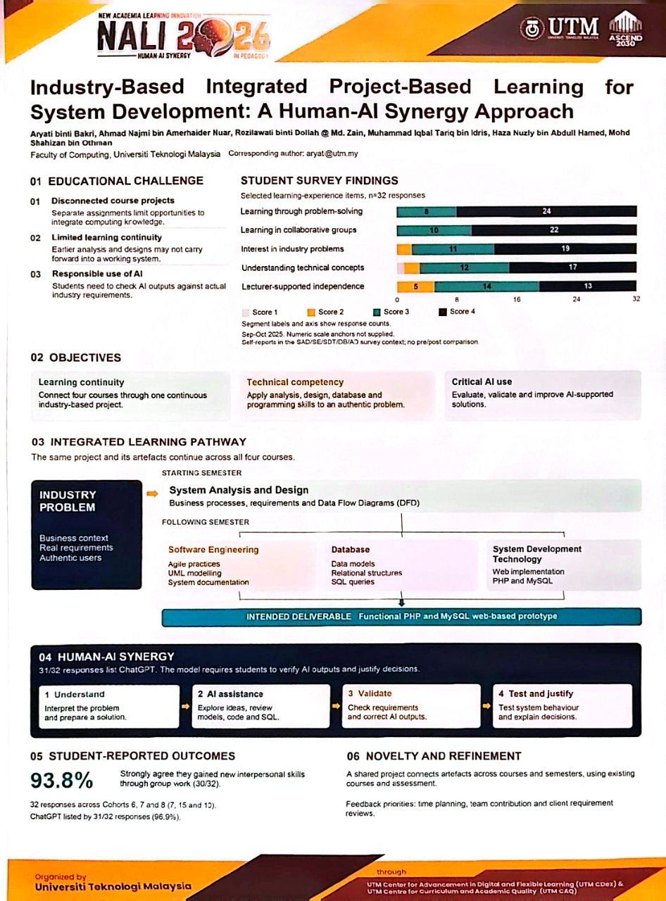

# 🎬 Assignment 1: NALI 2026 Video
- **📅 Event date:** 28–29 October 2026

---

## 🎥 Final Video

[Watch our NALI 2026 visit and interview video on YouTube](https://www.youtube.com/watch?v=_jAPp9ZF97w)

---

## 📋 Project Components

- **AI Avatar Introduction:** Introducing NALI 2026 and its role in teaching and learning innovation.
- **Poster Coverage:** Documenting selected ICT innovations for teaching and learning.
- **Interview Sessions:** Speaking with presenters and innovators about their educational technologies.
- **Group Reflections:** Sharing our learning points from the poster visits and interviews.
- **Video Production:** Combining the recordings with subtitles and a concluding reflection.

---

## 💡 Key Learning Outcomes

- Understanding how ICT supports more interactive and engaging learning experiences.
- Exploring the connection between research, teaching practice, and educational innovation.
- Strengthening communication, collaboration, interviewing, and video-production skills.

---

# 🤝 Group Collaboration & Team Members

* **TEY HAO RUI** (Matric number: A26CS0398)
* **LIM GUAN CHENG** (Matric number: A26CS0162)
* **TEE JIA XUAN** (Matric number: A26CS0392)
* **MUHAMMAD ADLI ZULFA BIN MOHAMAD ZAHID** (Matric number: A26CS0101)
* **MUHAMMAD AQIL ALHAY BIN ZULKARNAIN** (Matric: A26CS0206)
