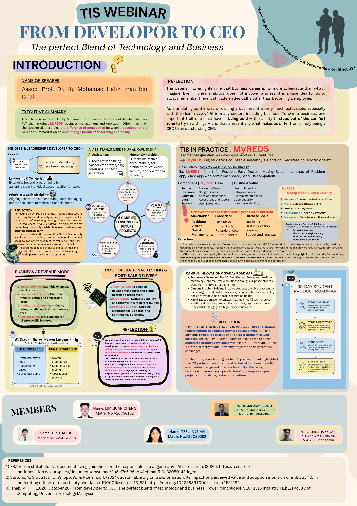

#Assignment 2
* **Date :** 9/11/2026

---

## Task Division

### [ Part 1: Intro & Executive Summary ] -- ADLI ZULFA
* **Write the **Executive Summary and Introduction (Speaker background & talk topic).**

### [ Part 2: Developer vs. CEO Mindset + Key Lessons ] -- TEE JIA XUAN
* **Summarize the shift from **Developer mindset to CEO mindset, and the 5 key lessons from the talk.**

### [ Part 3: TIS Components & MyREDS Case Study ] -- LIM GUAN CHENG
* **Summarize the **5 TIS components (People, Hardware, Software, Data, Process) and the 5-step Visitor Journey using the MyREDS case study.**

### [ Part 4: Business Model, Costs & Role of AI ] -- TEY HAO RUI
* **Summarize the **business/revenue model, cost considerations, and the role/limitations of AI in software work.**

### [ Part 5: Campus Product Challenge + Final Assembly ] -- AQIL
* **Summarize the **30-Day Student Roadmap / Campus Challenge framework (Observe > Prototype > Test > Pitch).**
