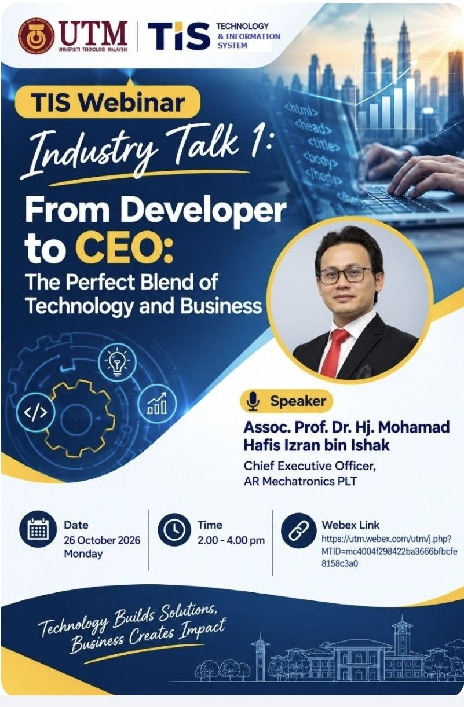
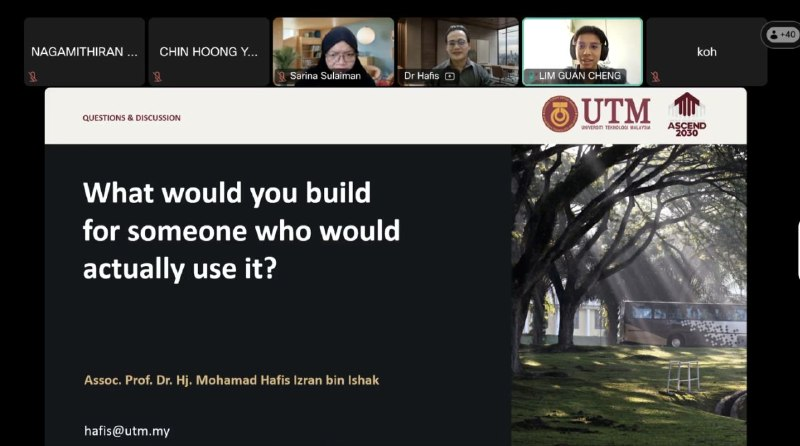

# 💡 Industry Webinar: From Developer to CEO — The Perfect Blend of Technology and Business

* **Event / Course:** SECP1513 Technology and Information System (TIS)
* **Organizer:** Faculty of Computing, Universiti Teknologi Malaysia (UTM)
* **Date:** 26 October 2026
* **Speaker:** Assoc. Prof. Dr. Hj. Mohamad Hafis Izran bin Ishak (CEO of AR Mechatronics PLT / Associate Professor at UTM)
* **Participant:** Lim Guan Cheng | Year 1 Computer Science (Computer Networks & Security) Student

---

## 🎯 Webinar Banner

---

## 🔑 Core Takeaways & Key Insights

Excited to share my individual reflection and key takeaways from the recent UTM Technology and Information System (SECP1513) webinar titled "From Developer to CEO: The Perfect Blend of Technology and Business" that I attended!

During the session, I asked the speaker about the key to keeping ourselves motivated, and the answer was simple yet powerful: to help.

Participating in this session, I learned how to translate theoretical TIS frameworks into practical, real-world architecture. Furthermore, analyzing the distinct needs of both buyers and users showed me how building digital trust in security features is vital for enhancing perceived value.

---

## 📝 Personal Reflection

This webinar gave a lot of inspiration. As Dr. Hafis told us about his experience transitioning from a lecturer to a CEO, stepping out of the comfort zone is never easy, but you never know what could happen if you don't even try!
