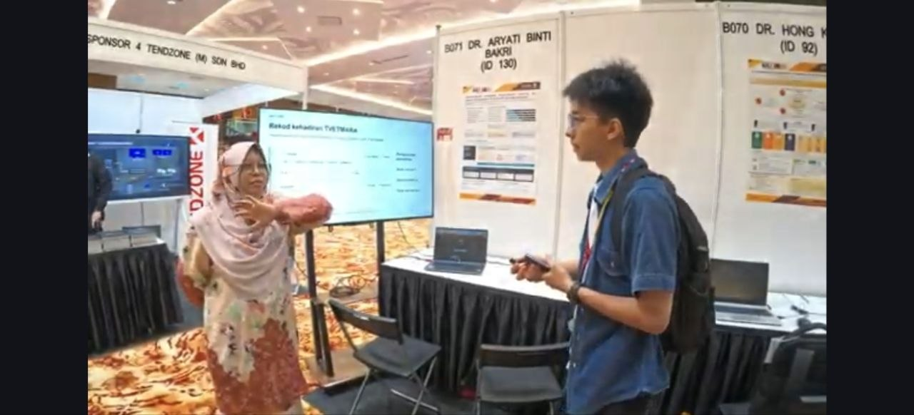
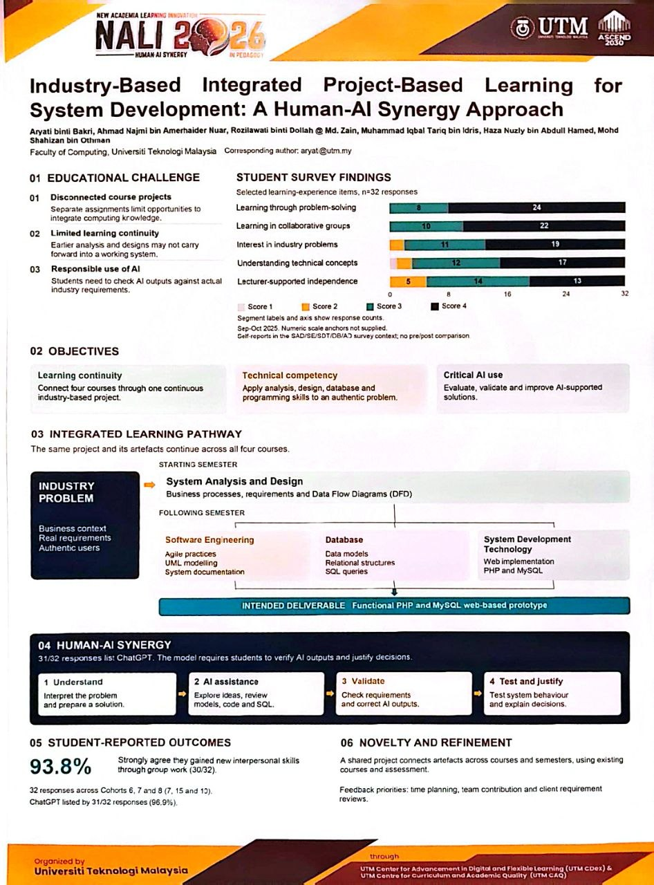
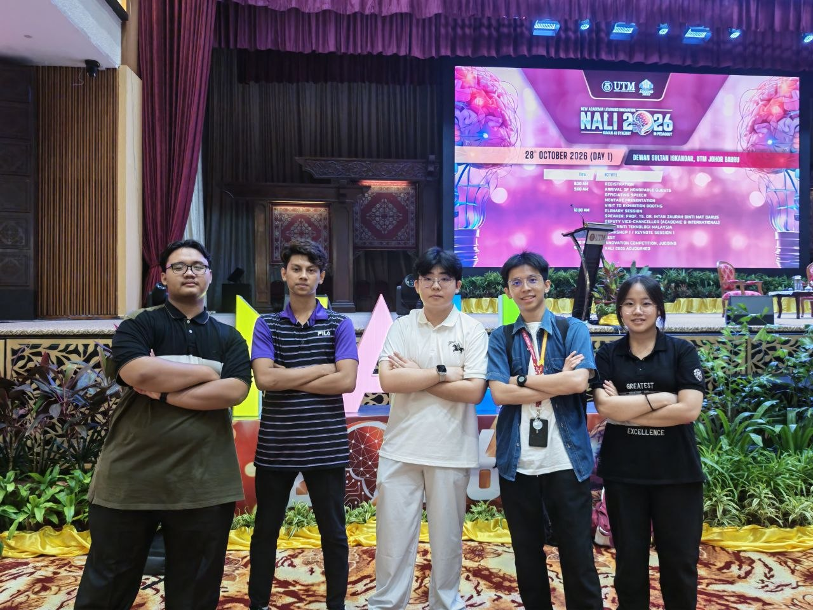

# 🎓 NEW ACADEMIA LEARNING INNOVATION 2026 (NALI2026) | Empowering Teaching and Research Connection

* 📅 **Date:** 28–29 October 2026

---

## 📖 Session Overview

I attended **NEW ACADEMIA LEARNING INNOVATION 2026 (NALI2026)** themed *"Empowerment of Teaching and Research Connections."* 

It was an inspiring experience to engage with educators, researchers, and presenters through interactive interview sessions, gaining deep insights into modern academic innovation, collaborative research, and emerging educational technologies.

---

## 🖼️ Media & Event Coverage

---

## 💡 Key Takeaways & Core Insights

* 🔬 **Bridging Research & Teaching:** Discovering the power of connecting empirical research with real-world teaching applications.
* 📚 **Pedagogical Innovation:** Exploring how innovative educational frameworks drive student engagement and active learning.
* 🌐 **Interdisciplinary Collaboration:** Building stronger connections across academic communities and diverse research fields.

> *Grateful for the opportunity to learn, exchange ideas, and witness the future of educational innovation in action!*

---

## 👥 Group Collaboration & Team Members

* **TEY HAO RUI (Matric No: A26CS0398)**
* **LIM GUAN CHENG (Matric No: A26CS0162)**
* **TEE JIA XUAN (Matric No: A26CS0392)**
* **MUHAMMAD ADLI ZULFA BIN MOHAMAD ZAHID (Matric No: A26CS0101)**
