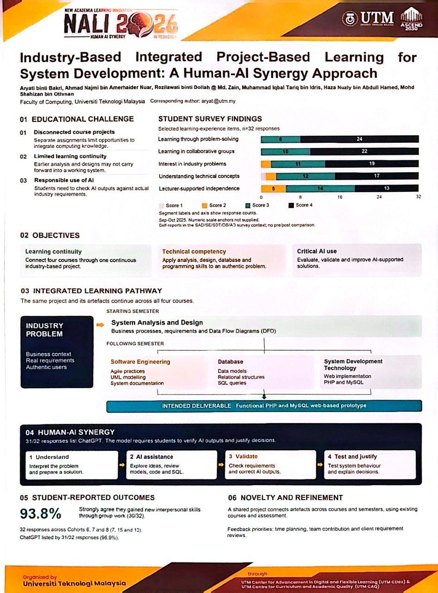
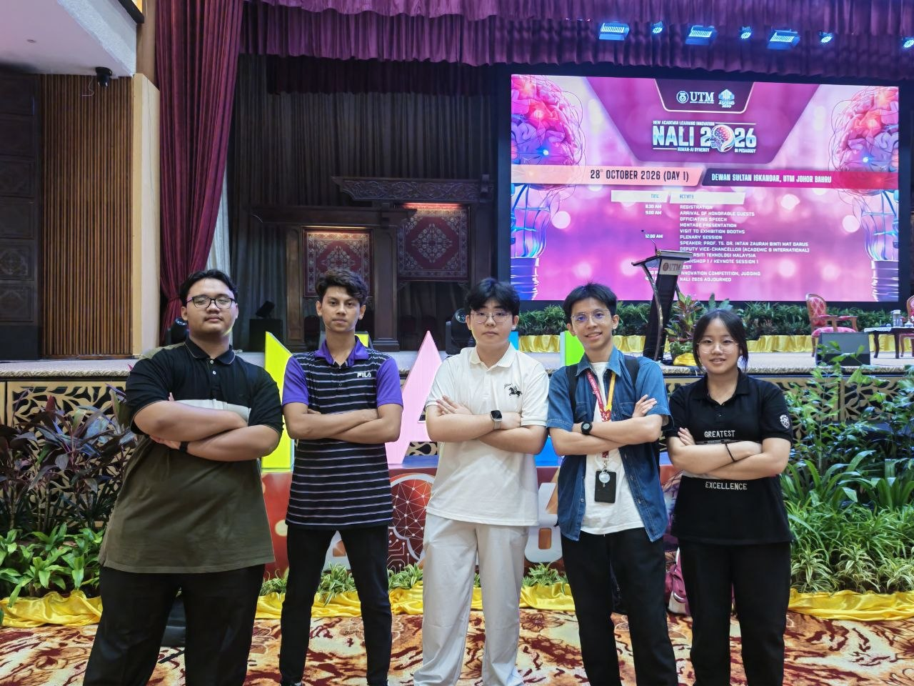

# 🎓 NEW ACADEMIA LEARNING INNOVATION 2026 (NALI2026) | Empowering Teaching and Research Connection

* 📅 **Date:** 28–29 October 2026

---

## 📖 Session Overview

I attended **NEW ACADEMIA LEARNING INNOVATION 2026 (NALI2026)** themed *"Empowerment of Teaching and Research Connections."*

It was an inspiring experience to engage with educators, researchers, and presenters through interactive interview sessions, gaining deep insights into modern academic innovation, collaborative research, and emerging educational technologies.

---

## 🖼️ Media & Event Coverage

---

## 💡 Key Takeaways & Core Insights

* 🔬 **Bridging Research & Teaching:** Discovering the power of connecting empirical research with real-world teaching applications.
* 📚 **Pedagogical Innovation:** Exploring how innovative educational frameworks drive student engagement and active learning.
* 🌐 **Interdisciplinary Collaboration:** Building stronger connections across academic communities and diverse research fields.

> *Grateful for the opportunity to learn, exchange ideas, and witness the future of educational innovation in action!*

---

## 🤖 AI Avatar & Video-Production Workflow

For the group introduction, we used **HeyGen** to create an AI avatar. During production, we identified the limitations of HeyGen's free plan. To work within those constraints, we:

1. Transcribed the interview-video content.
2. Prepared the narration script for the relevant sections.
3. Used AI-generated speech audio for the narration.
4. Integrated the generated audio into the final video as a practical workaround for the free-plan limitations.

---

## 🧩 My Contributions

After group discussion, I was responsible for:

* Creating the **group introduction** section.
* Preparing captions for **my segment**, **Aqil's segment**, and **Tee's segment**.
* Supporting the **final audit** of the completed video before submission.

---

## 👥 Group Collaboration & Team Members

* **TEY HAO RUI (Matric No: A26CS0398)**
* **LIM GUAN CHENG (Matric No: A26CS0162)**
* **TEE JIA XUAN (Matric No: A26CS0392)**
* **MUHAMMAD ADLI ZULFA BIN MOHAMAD ZAHID (Matric No: A26CS0101)**
* **MUHAMMAD AQIL ALHAY BIN ZULKARNAIN (Matric: A26CS0206)**
