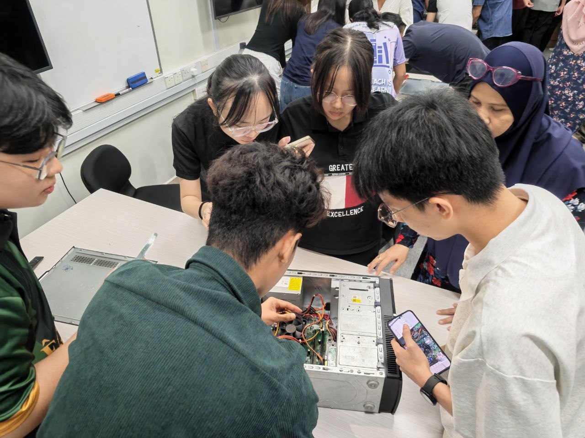
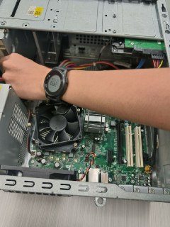
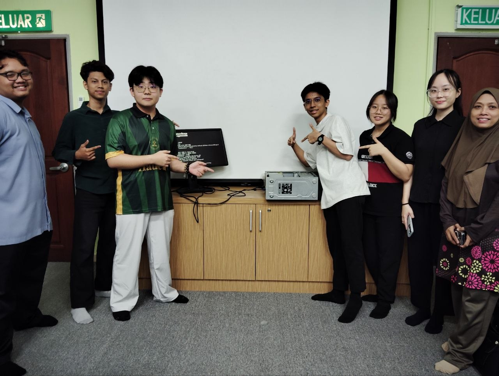
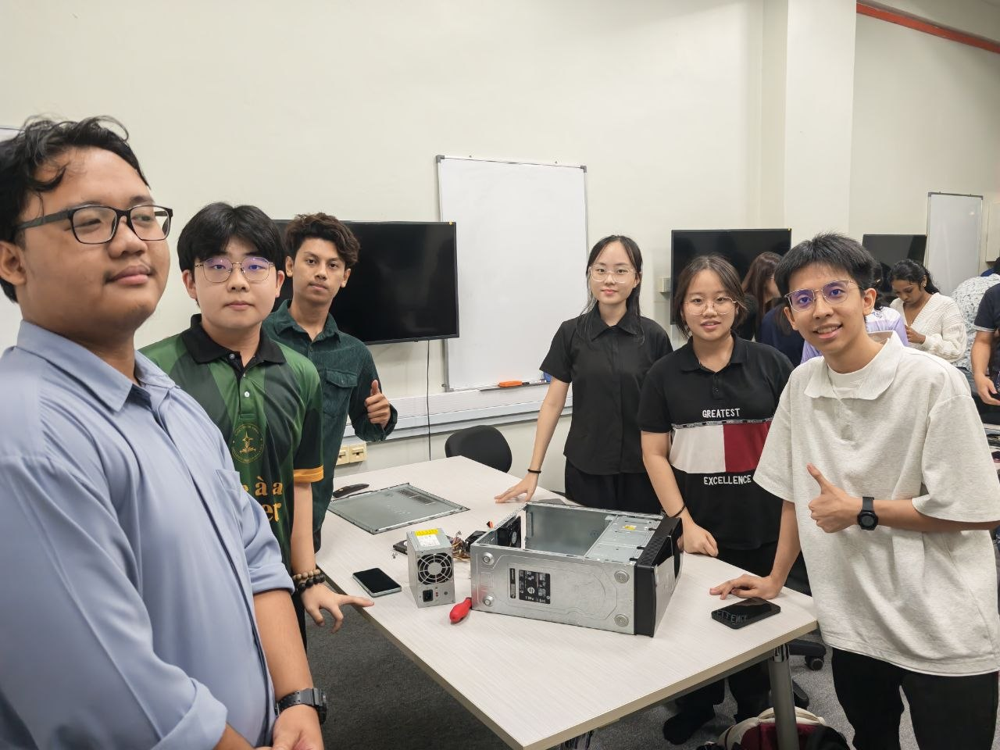

#🛠️ Practical Session: Desktop Computer Hardware Assembly

---

* **Date:** 3 November 2026

Session Focus: Internal Hardware Structure & PC Assembly
---

---

## 💻 Core Components Explored & Their Functions
* **CPU Cooling Fan:** Responsible for thermal management, actively dissipating heat away from the processor to prevent overheating and maintain performance.

* **Hard Disk Drive (HDD):** Traditional non-volatile magnetic storage used for holding long-term data, operating systems, and large files.

* **RAM (Random Access Memory):** High-speed volatile memory that temporarily holds data currently in use by the CPU for rapid access.

* **Motherboard:** The central circuit board that physically houses, connects, and enables data communication between all internal hardware parts.

* **Power Supply Unit (PSU):** Converts household alternating current (AC) power into the low-voltage direct current (DC) power required by internal components.

---

## 🔑 Key Takeaways & Lessons Learned
* **Hands-on Assembly & Identification:** Gained direct, practical experience handling physical computer parts, recognizing specific slots, power connectors, and structural layouts within a computer case.

*Crucial Troubleshooting Lesson (RAM Seating):* Discovered firsthand that RAM requires precise handling and firm, even pressure to seat correctly. During our session, improper RAM installation resulted in multiple failed boot attempts and system errors. By carefully diagnosing the slots, re-aligning, and fully clicking the RAM modules into place, we successfully resolved the issue.

---

## 📝 Reflection
This practical session effectively bridged theoretical computer architecture concepts with physical execution. Encountering and troubleshooting real-world assembly hurdles—such as component seating errors—greatly strengthened my problem-solving mindset and technical foundations for my Cyber Security journey.

---

## 👥 Group Collaboration & Team Members

* **TEY HAO RUI** (Matric number: A26CS038)
* **LIM GUAN CHENG** (Matric number: A26CS0162)
* **TEE JIA XUAN** (Matric number: A26CS0392)
* **MUHAMMAD ADLI ZULFA BIN MOHAMAD ZAHID** (Matric number: A26CS0101)
* *Additional member : TEW JIA XIN (Matric number: A26cs0399)*

